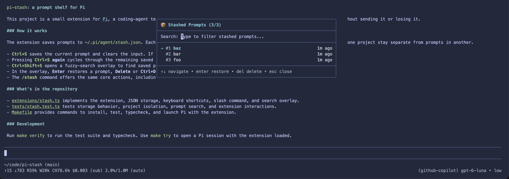
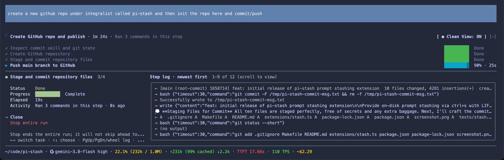
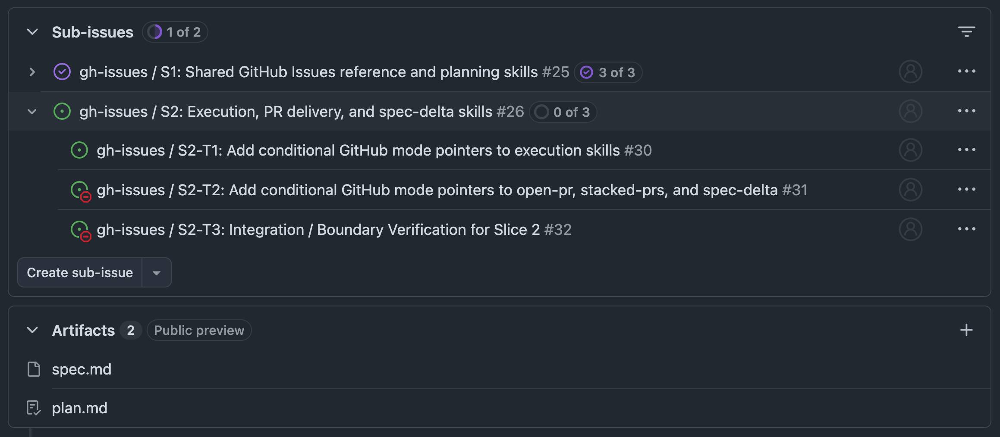
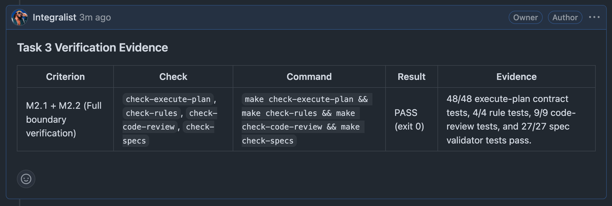
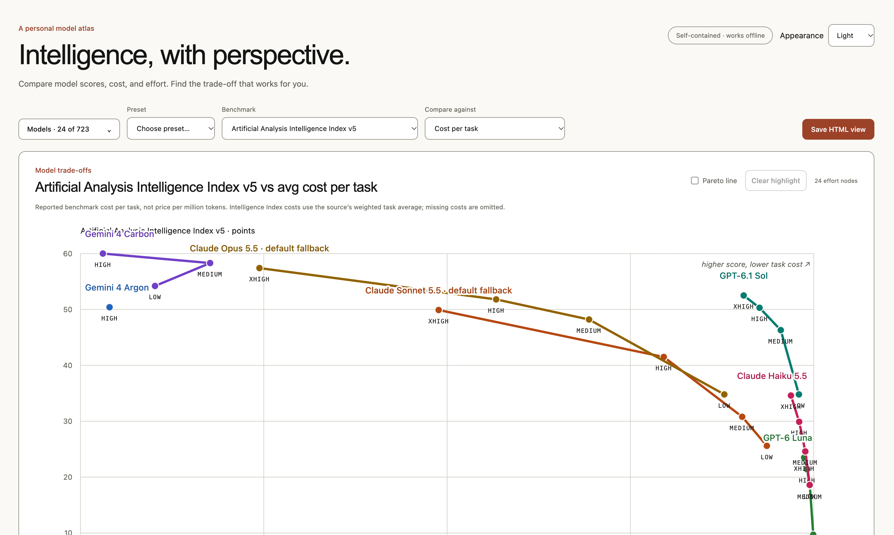
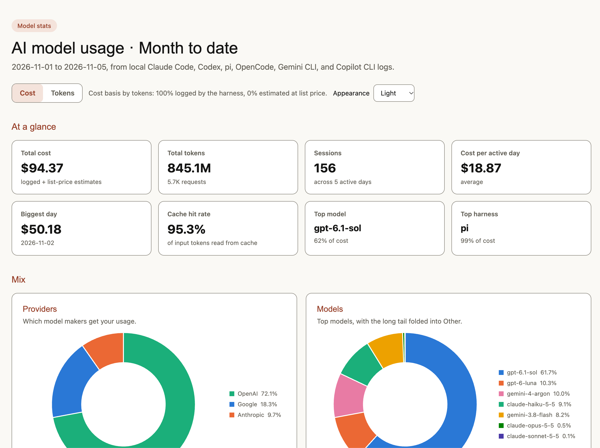
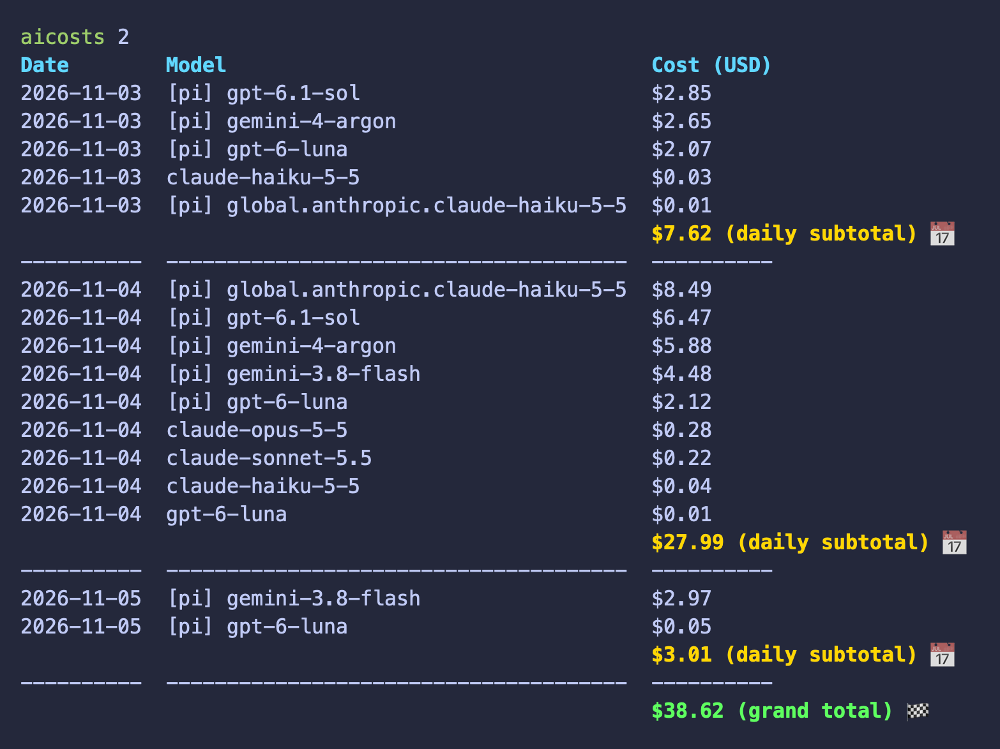

Most chat around using AI for engineering seems to land on two extremes:
either people claiming agents will replace developers by next month, or
complete cynicism because a model botched a regex. Neither feels particularly
helpful to be honest.

I use coding agents every single day across multiple codebases. I don't treat
them like magical answers to everything, and I definitely don't let them dump
unvetted code into my repositories. For me, an agent is essentially a very fast,
enthusiastic junior engineer who happens to be a bit careless if you leave them
unsupervised. That means giving them strict boundaries, making TDD
non-negotiable, and having zero patience for apologies or boilerplate slop.

All of this lives in my
[`agent-skills`](https://github.com/Integralist/agent-skills) repo. Here is a
look at the mental model, the setup, and how work actually gets done.

> [!NOTE]
> AI likes emojis. Guess what... so do I. Get over it 😂

## 🔌 Engineering Around the Harness

There are only a handful of serious CLI agent harnesses out there: Claude Code,
Pi, OpenCode, Gemini CLI, and Copilot CLI. Each makes different architectural
trade-offs, and out of the box, none of them give you everything you want as an
engineer. Rather than settling for whatever a harness ships with, or complaining
about missing features, I treat them like any other tool in my stack: if there is
a gap in my daily workflow, I build what is needed to solve it.

I started this approach with OpenCode. I liked its initial promise, but it was
missing several capabilities I needed for serious work: prompt history search,
subagent cost tracking, and skill autocomplete. Rather than abandoning it, I
[forked it to fix a bunch of
issues](https://github.com/Integralist/opencode/blob/custom-features/FORK.md#changelog)
and implemented those features directly. I tried contributing them back
upstream, but with hundreds of PRs sitting stale and an unresponsive maintainer,
none of it got merged. It wasn't for lack of trying, but I quickly realised
OpenCode had too many architectural headaches under the hood and wasn't going to
work out long term.

So I moved over to the Pi harness instead. Pi gave me a much cleaner foundation
and a proper extension model, but I still wanted deeper capabilities like
subagent orchestration, persistent prompt history, richer status telemetry,
transcript highlighting, side conversations, inline skill argument hints,
declarative event hooks, prompt stashing, and in-place context shaking. So I built extensions for
all of them:

> [!WARNING]
> I'm a Go dev. Pi extensions are Typescript. So these extensions are totally vibe coded. Don't judge me. 

- [`pi-subagents`](https://github.com/Integralist/pi-subagents)
- [`pi-prompt-history`](https://github.com/Integralist/pi-prompt-history)
- [`pi-statusbar`](https://github.com/Integralist/pi-statusbar)
- [`pi-transcript-enhancer`](https://github.com/Integralist/pi-transcript-enhancer)
- [`pi-btw`](https://github.com/Integralist/pi-btw)
- [`pi-skill-argument-hints`](https://github.com/Integralist/pi-skill-argument-hints)
- [`pi-event-hooks`](https://github.com/Integralist/pi-event-hooks)
- [`pi-context-shake`](https://github.com/Integralist/pi-context-shake)
- [`pi-stash`](https://github.com/Integralist/pi-stash)

Let's take a moment to consider that last extension,
[`pi-stash`](https://github.com/Integralist/pi-stash). How many times have
you typed out a detailed, multi-step prompt, only to realise you need to ask
a quick clarifying question or run an ad-hoc command first? Instead of
cutting text to the clipboard and praying you don't clobber it, pi-stash
brings git-style stashing to the prompt box: pressing `Ctrl+Alt+S` shelves
your in-progress prompt to disk and clears the editor. Pressing `Ctrl+Alt+S`
again on an empty prompt pops it right back, while `Ctrl+Shift+S` pops open
an interactive fuzzy-search overlay to search, restore, or prune older stashed
prompts:



I also wanted Pi to feel a bit less noisy while it was working. In Claude Code,
I'd already made a custom mod to keep useful progress visible without dumping
raw tool output into the terminal, so I built
[`pi-clean-view`](https://github.com/Integralist/pi-clean-view) to bring that
same focused experience to Pi. It hides tool calls and output behind a checklist,
with progress meters and status labels like "Needs you", "Stuck", and "All
done". Pressing `Ctrl+Spacebar` reveals all the hidden details in a floating
overlay whenever you need them.



A similar gap existed with lifecycle hooks. Claude Code supports declarative
shell hooks (`PreToolUse`, `PostToolUse`, `Notification`) in JSON, making it
trivial to block dangerous commands, format files after edits, or pop desktop
alerts. Pi has a powerful event API (`pi.on(...)`), but writing a full
TypeScript extension just to run a one-line bash script is overkill for most
people (but not me 😅). I built
[`pi-event-hooks`](https://github.com/Integralist/pi-event-hooks) to bring
declarative JSON hooks to Pi. It maps both native Pi events and Claude Code
aliases onto shell commands from `~/.pi/agent/hooks.json` or `.pi/hooks.json`.
Hooks can also help block risky calls (like `git push --force` or touching
`.env`) by returning an exit code `2`, or mutating arguments on the fly, or
trigger formatters on tool completion without maintaining separate extensions.

Then there's prompt history. Claude Code keeps a persistent, searchable
history across sessions, so you can easily pull up prompts you ran earlier.
In Pi, arrow history is scoped strictly to the active session. The second you
start a new session or switch branches, you're back to retyping past prompts,
slash commands, or shell invocations from memory. To fix that, I built
[`pi-prompt-history`](https://github.com/Integralist/pi-prompt-history). It
brings readline-style `Ctrl+R` reverse-search across the active session, the
current project, or all historical sessions in `~/.pi/agent/sessions/`. It
normalises expanded skills back to `/skill:<name>` calls, deduplicates repeated
prompts, and drops the match straight back into the editor.

The reality of extending harnesses, though, is that there is no cross-harness
standard for runtime plugins. When you write a TypeScript extension for Pi or
patch Go code in OpenCode, you are writing against that runtime's bespoke APIs.
If you switch harnesses later down the road, that glue code has to be adapted.
Building custom extensions is worth the effort for daily ergonomics, but it
means you shouldn't tie your core intelligence or prompts to any single runtime.

## 📐 Standardisation

What *can* be standardised, however, is the actual intelligence: the prompt
logic, workflows, and operational conventions. The
"[Skills](https://agentskills.io/)" format gives us a portable way to do that.
By keeping the core skills and conventions strictly harness-agnostic, the way I
actually _work_ isn't locked into Pi, Claude Code, or anything else (even if
some of the _niceties_ of the UI experience I've developed are).

My `agent-skills` repo reflects this separation with a single source of truth:

```txt
.agents/                            # Canonical skills + conventions
├── AGENTS.md                       # Shared operational conventions
└── skills/                         # Canonical skills (1 dir per skill)
    └── shared/                     # Shared formats and policies

.claude/                            # Claude Code adapter
├── CLAUDE.md                       # Pointer to ~/.agents/AGENTS.md
├── rules/                          # Auto-generated path-scoped rules
└── skills -> ../.agents/skills     # Symlink to canonical skills

.pi/agent/                          # Pi harness configuration
├── settings.json                   # Defaults, models, and packages
└── themes/nord-contrast.json       # Custom theme

mcp/google-workspace/               # Bundled Google Workspace MCP server
```

The core directory is `.agents/skills/`. Every skill is written using generic
instructions ("prompt the user", "spawn a subagent", "read the file"). Claude
Code gets access via a symlink (`.claude/skills -> ../.agents/skills`), while Pi
or Gemini CLI load them straight from `~/.agents/skills/`.

To stop skills turning into bloated, harness-specific walls of text, I enforce
strict authoring rules via
[`writing-for-agents`](https://github.com/Integralist/agent-skills/blob/main/.agents/skills/writing-for-agents/SKILL.md)
(I also wrote
[`skill-rewrite`](https://github.com/Integralist/agent-skills/blob/main/.agents/skills/skill-rewrite/SKILL.md)
after discovering what a poor job I had done with some of them 😅) to keep each
skill short enough to read in one pass. It's important to realise that, yes, in
our upcoming near future, agents are reading everything instead of us, but it's
important for us to understand EXACTLY what we're asking of those agents and
it's often too easy to just ask an agent "hey, create a new skill to do X"
without keeping tight reigns on what is being produced. Every unmonitored input
and output is a token, and that means time and money.

Skill's have a frontmatter field called `description` which is terribly named
because essentially it is describing the _trigger_ conditions (when to load the
skill, not a duplicate summary of how it works). Often I'll find that multiple
skills benefit (like code) from specific instructions or formats to be extracted
into shared contracts (`SPEC-FORMAT.md`, `ADR-FORMAT.md`, `PR-DESCRIPTION.md`,
`BUILD-ITEM.md`). I place these into `.agents/skills/shared/` so linked
workflows never drift.

When Claude Code supports handy features like path-scoped rules in
`.claude/rules/`, I generate them automatically from the canonical conventions
skills (`conventions-go`, `conventions-python`, and so on) via `make rules`.

Similarly, Claude Code supports an `argument-hint` frontmatter key in `SKILL.md`
to show syntax hints when typing slash commands (such as `[--edit] [--days N]`
for my
[`talking-points`](https://github.com/Integralist/agent-skills/blob/main/.agents/skills/talking-points/SKILL.md)
skill). Pi does not display these natively, so I wrote
[`pi-skill-argument-hints`](https://github.com/Integralist/pi-skill-argument-hints)
to bridge the gap. So now, when typing `/skill:<name>`, it reads the frontmatter
verbatim and renders a muted inline hint right after the cursor that auto-hides
the moment you type an argument or space.

Although I typically only really use the Pi harness now, I like to keep my
agent-skills working across multiple harnesses, and so my repo has a handy
installation script that synchronises everything:

```bash
# Install everything across all harnesses cleanly
make install
```

`make install` also uses
[`scripts/op-inject.sh`](https://github.com/Integralist/agent-skills/blob/main/scripts/op-inject.sh)
to inject 1Password secrets for API keys and MCP configs at install time. If
1Password isn't signed in, it quietly skips those injections instead of
blowing up.

## 📜 Ground Rules (Stop the Fluff)

Left to their own devices, agents default to people-pleasing nonsense. They
apologise constantly, hallucinate libraries, churn out paragraphs of
throat-clearing filler, and edit files nobody asked them to touch. My global
`AGENTS.md` sets the boundaries so we don't have to have that argument every
session.

### 💬 1. Communication and Tone

- **Cut the sycophancy:** Drop the "I would be delighted to help with that!"
  nonsense. Lead with the direct answer.
- **Keep it brief:** Shortest complete response wins. Cap lists at around five
  items and group them by priority (see also my
  [voice-adhd](https://github.com/Integralist/agent-skills/blob/main/.agents/skills/voice-adhd/SKILL.md),
  [summarize-for-adhd](https://github.com/Integralist/agent-skills/blob/main/.agents/skills/summarize-for-adhd/SKILL.md)
  and
  [summarize-for-product](https://github.com/Integralist/agent-skills/blob/main/.agents/skills/summarize-for-product/SKILL.md)
  skills that are all related to communication and tone of voice).
- **Bound the steps:** If a task takes multiple steps, number them upfront so I
  know where we are. My
  [`pi-transcript-enhancer`](https://github.com/Integralist/pi-transcript-enhancer)
  extension parses progress labels (like `Step X/Y: <summary>`) and renders them
  as high-contrast gold blocks in the TUI, keeping long sessions scannable at a
  glance without modifying the raw message sent to the model.
- **No robotic fluff:** Drop literary flourishes. Keep the tone warm,
  plainspoken, and peer-to-peer.
- **Load-bearing emoji only:** Emoji are fine if they signal status faster than
  words (✅ pass, ❌ fail, ⚠️ caution). Otherwise keep them out of running
  prose and code.

### 🧪 2. Engineering Discipline & TDD

- **Strict TDD:** No production code without a failing test first. Stub first,
  prove failure on assertion (not compilation failure), write the minimum code to
  pass, and delete assertions that survive an inverted requirement (see also my
  [go-testing](https://github.com/Integralist/agent-skills/tree/main/.agents/skills/go-testing)
  skill).
- **Simplicity over layers:** I prefer solving problems by removing components
  rather than stacking abstractions or wrapper functions (see my
  [code-module-design](https://github.com/Integralist/agent-skills/blob/main/.agents/skills/code-module-design/SKILL.md)
  and
  [code-module-review](https://github.com/Integralist/agent-skills/blob/main/.agents/skills/code-module-review/SKILL.md)
  skills).
- **Cite actual sources:** Never guess an API signature or config header from
  vague memory. Cite the file and line number
  (`internal/parser/frontmatter.go:42`), or explicitly flag it as an unverified
  assumption.

### ✋ 3. Sceptical Code Edits

- **Ask before editing:** An inquiry is just an inquiry, not an open invite to
  start hacking on files. The agent has to propose the diff in chat and wait for
  approval before running edit tools.
- **Summarise large diffs:** Anything over 40 lines gets a one-line summary
  first, rather than dumping a massive wall of code into chat unprompted.

## ⚙️ The Skill Pipeline: How Work Actually Gets Done

A common mistake is asking an agent to "build feature X" in a single prompt.
That almost always produces over-engineered junk (and a massive headache to
debug). Instead, I break work down into a pipeline of smaller, specialised
skills.

```txt
Product track:     pdd (project → discovery → design) ─┐
                                                       ├─→ architect (spec → grill → plan) → to-tasks → next-task / next-slice
Engineering track: architect (bootstrap → research) ───┘
```

### 🕵️ Phase 1: Interrogation (Poking Holes First)

Before touching code, the idea needs stress-testing.

- [**`clarify`**](https://github.com/Integralist/agent-skills/blob/main/.agents/skills/clarify/SKILL.md):
  Digs into what you actually want when a prompt is too vague. It asks targeted
  questions to remove ambiguity upfront.
- [**`grilling`**](https://github.com/Integralist/agent-skills/blob/main/.agents/skills/grilling/SKILL.md)
  (and
  [`grill-me`](https://github.com/Integralist/agent-skills/blob/main/.agents/skills/grill-me/SKILL.md),
  [`grill-with-docs`](https://github.com/Integralist/agent-skills/blob/main/.agents/skills/grill-with-docs/SKILL.md)):
  Puts the idea through an adversarial interrogation. The agent relentlessly
  challenges your assumptions, edge cases, and architecture choices across the
  design tree.
- [**`perspectives`**](https://github.com/Integralist/agent-skills/blob/main/.agents/skills/perspectives/SKILL.md)
  &
  [**`decide`**](https://github.com/Integralist/agent-skills/blob/main/.agents/skills/decide/SKILL.md):
  Evaluates alternatives through structured lenses (risks, benefits, costs) and
  produces a durable decision memo or ADR (Architecture Decision Record).
- [**`consensus`**](https://github.com/Integralist/agent-skills/blob/main/.agents/skills/consensus/SKILL.md):
  Drives cross-model debate through gated discussion rounds, preserving healthy
  dissent when evaluating high-stakes architectural choices.
- [**`arena`**](https://github.com/Integralist/agent-skills/blob/main/.agents/skills/arena/SKILL.md):
  Runs parallel candidate attempts across multiple models for tricky pieces where
  a single shot risks locking in the wrong shape. It scores candidates against a
  concrete rubric via an independent cross-judge, picks a base, and borrows the
  best bits from the runners-up.

### 📐 Phase 2: Architecture and Planning (Before the Code Rot)

Once an idea survives the initial interrogation, it needs structuring. But not
all work starts from the same place. Some initiatives are cross-functional,
needing agreement between Product and Engineering on scope, milestones, and
system design. Others are purely engineering-led problems where we already know
we need to build something, but need to research the shape and plan the work.

My setup splits this into two distinct tracks: `pdd` for cross-functional
initiatives, and `architect` for engineering-led features.

#### Cross-functional alignment: `pdd`

When Product and Engineering need to agree before anyone touches code, I use
[`pdd`](https://github.com/Integralist/agent-skills/blob/main/.agents/skills/pdd/SKILL.md)
(Project, Discovery, Design). It treats governance as a series of three
explicit, human-in-the-loop approval gates:

1. **Project (`project.md`)**: Agrees on what the initiative actually is, why
   it matters, and when milestones should land.
2. **Discovery (`discovery.md`)**: Evaluates solution directions and trade-offs
   for a milestone without committing to implementation details.
3. **Design (`design.md`)**: Documents the approved system-level architecture
   thoroughly enough for Product, Engineering, and reviewers to sign off.

Unlike most agent skills that run through to the end autonomously, `pdd` stops
dead at each gate (`Awaiting approval`). It refuses to advance to Discovery
until Project is approved, and will not touch Design until Discovery is signed
off.

Crucially, `design.md` is not an implementation plan (`plan.md`). It answers
what system solution is being approved, not how an engineer will slice the pull
requests. Once Design is approved, `pdd` hands off to
[`architect`](https://github.com/Integralist/agent-skills/blob/main/.agents/skills/architect/SKILL.md)
(see following section) starting at its Spec step, skipping bootstrap and
research so both tracks share one engineering chain without duplicating the
discovery you just agreed upon.

#### Engineering-led coordination: `architect`

When an initiative is driven entirely by engineering, running through a
three-stage product governance dance is overkill. That is where `architect`
comes in.

Where `pdd` is a gated approval workflow for cross-functional consensus,
`architect` is a thin six-step coordinator for engineering delivery. It
sequences other skills in a single `projects/<yyyy-mm-dd>-<slug>/` folder:
bootstrapping project rules
([`agents-md`](https://github.com/Integralist/agent-skills/blob/main/.agents/skills/agents-md/SKILL.md),
plus `clarify` if the idea is vague), deep research
([`research`](https://github.com/Integralist/agent-skills/blob/main/.agents/skills/research/SKILL.md)),
writing the functional specification
([`to-spec`](https://github.com/Integralist/agent-skills/blob/main/.agents/skills/to-spec/SKILL.md)),
adversarial stress-testing (`grill-with-docs`), implementation planning
([`to-plan`](https://github.com/Integralist/agent-skills/blob/main/.agents/skills/to-plan/SKILL.md)
followed by
[`to-adr`](https://github.com/Integralist/agent-skills/blob/main/.agents/skills/to-adr/SKILL.md)
to record genuine architectural decisions, and an optional
[`to-prd`](https://github.com/Integralist/agent-skills/blob/main/.agents/skills/to-prd/SKILL.md)
when the project didn't start from a PDD Design), and finally handing off to
execution.

If `pdd` is about deciding what to build with Product, `architect` is about
taking an engineering idea (or an approved PDD Design) and generating the
technical artefacts needed to build it safely.

#### The engineering handoff: specs, plans, and tasks

Regardless of whether an initiative starts in `pdd` or `architect`, both tracks
converge on the same engineering delivery pipeline under
`projects/<yyyy-mm-dd>-<slug>/`:

- **`to-spec` &
  [`spec-delta`](https://github.com/Integralist/agent-skills/blob/main/.agents/skills/spec-delta/SKILL.md)**:
  `to-spec` writes `spec.md` with user stories (framed with
  [`voice-product`](https://github.com/Integralist/agent-skills/blob/main/.agents/skills/voice-product/SKILL.md)),
  Gherkin acceptance criteria, and testing seams. Current truth lives in
  `docs/specs/<capability>.md` and is validated in CI; whenever a change alters
  existing behaviour, `to-spec` and `spec-delta` record a `Behavioural Delta`
  against the pinned baseline so the project folder keeps the history while the
  living spec moves on.
- **`to-plan`**: Breaks the specification (or a session's discussion when a spec
  isn't needed) into vertical implementation slices (`plan.md`) with `Blocked by`
  dependencies, exact `Consumes`/`Produces` interface signatures, verifiable
  outcome milestones (`M1.1`, `M1.2` rather than step-by-step tasks), and PR
  delivery groupings.
- **`to-tasks`**: Compiles a single plan slice just-in-time against live code
  into a mechanical, TDD-shaped task list (`tasks.md` or `tasks-slice-N.md`)
  with verbatim stubs, failing tests (`red`), implementations (`green`),
  runnable verification commands, `Supports:` links back to plan milestones, and
  a closing integration task that runs the slice's Gherkin scenarios without
  mocks.

#### Automating the handoff: `execute-plan`

Until now, I've described a manual loop: run `to-tasks` for a slice, then start
[`next-task`](https://github.com/Integralist/agent-skills/blob/main/.agents/skills/next-task/SKILL.md)
or
[`next-slice`](https://github.com/Integralist/agent-skills/blob/main/.agents/skills/next-slice/SKILL.md),
and repeat. It works, but I'm the one joining the steps up and keeping track of
what comes next.

[`execute-plan`](https://github.com/Integralist/agent-skills/blob/4601fe188be2b7a4001c40197eb533491f01570d/.agents/skills/execute-plan/SKILL.md)
turns that choreography into one coordinated workflow. I give it an existing
plan and keep my main conversation as the coordinator so its context window
lasts the whole plan. For each unblocked slice, a premium subagent follows
`to-tasks` to write the task list against live code, and a cheap subagent
implements one task at a time (both staying on the session's provider and
changing only the model and effort). The coordinator inspects each diff, runs
the checks, diagnoses failures, and commits verified tasks before moving on. It
accepts each slice against its milestone outcomes (running a read-only review on
risky slices), finishes with a requirement-by-requirement audit against the plan
and spec, and logs task-to-commit mappings in `execution.md` so resuming never
depends on chat history.

The value isn't handing decisions to a cheaper model. It's avoiding the manual
skill-to-skill handoffs while keeping verification and acceptance with the
coordinator. ~~I do give up some of the minute-by-minute control~~I have a verification agent run to validate the code against my `convention-*` standards so I don't have to hand-hold every line of code; but occasionally when I'm
working manually I like to course-correct code to match my conventions or
preferences depending on what I'm working on. In practice, those tend to be small syntax or style adjustments,
not problems with the code or the planned approach. So I can let the task loop
run, review the final code and complete commit list, suggest any small edits,
then decide whether to push or open a PR. That makes the overall flow faster
for me.

By default it confirms the setup and asks when design questions come up. Passing
`auto` (`/skill:execute-plan <plan-path> auto`) lets it run unattended through
all slices and the final audit, logging each non-trivial decision in
`execution.md`. Both modes still stop hard if staging is unsafe, three fixes
fail on the same problem, the worker model can't be verified, the provider runs
out of credits, a commit would land on `main`/`master` without approval, or the
PDD Design isn't approved. It never pushes or opens PRs, and I can still run the
individual skills manually whenever I want to stay closer to each step.

#### Ditching on-disk clutter: GitHub Issues & Artifacts

Keeping everything in `projects/<yyyy-mm-dd>-<slug>/` on disk works well, but it
does have a few annoying side effects. Every feature ends up generating half a
dozen working files (`README.md`, `spec.md`, `plan.md`, `tasks-slice-1.md`,
`execution.md`) that sit in your working tree, pad out pull request diffs with
hundreds of lines of planning prose that reviewers have to scroll past, and
need a bookkeeping commit at the end just to shuffle the folder into
`projects/completed/`.

To give myself a cleaner option, I added an opt-in GitHub Issues backend
([PR #33](https://github.com/Integralist/agent-skills/pull/33), dogfooded
through [Issue #24](https://github.com/Integralist/agent-skills/issues/24)).
Passing `github` or an issue number (`/skill:architect github`,
`/skill:to-plan #24`, `/skill:next-slice #25`) switches the skills over to a
shared
[`GITHUB-ISSUES.md`](https://github.com/Integralist/agent-skills/blob/main/.agents/skills/shared/GITHUB-ISSUES.md)
protocol while leaving the on-disk workflow untouched as the default. Because
each skill only has a single conditional pointer line, normal on-disk runs
don't pay a single extra token for the GitHub instructions.

What makes this work so nicely in practice is combining two newer `gh` CLI
capabilities: **Issue Artifacts** (`gh issue artifact`) and native
**Sub-Issues** (`--parent` and `--blocked-by`). Durable repository truth
(`docs/specs/*.feature`, `docs/adr/`, `GLOSSARY.md`) still lives in Git where it
belongs, while the ephemeral project workspace maps onto a 3-level issue tree:

1. **Root Project Issue (`--label project`, `<Title> (<slug>)`)**: Acts as the
   project folder and `README.md` index. All the real documents (`spec.md`,
   `plan.md` with `--type plan`, `research.md`, project ADRs, and
   `execution.md`) attach directly to this root issue as versioned Issue
   Artifacts rather than cluttering the repository tree.
2. **Slice Sub-Issues (`--label slice`, `<slug> / S1: <Title>`)**: Created under
   the root issue with `--parent` and chained with `--blocked-by`. The slice
   body holds its own milestone outcomes (`M1.1`, `M1.2`), interface signatures,
   acceptance verification table, and executor context.
3. **Task Sub-Issues (`--label task`, `<slug> / S1-T1: <Title>`)**: Compiled
   just-in-time per slice by `to-tasks` under the parent slice issue, each
   holding the exact failing test (`red`), implementation guidance (`green`),
   and verification command.



Compared to editing local Markdown files, the execution loop is much cleaner
and more token-efficient. Instead of an agent re-reading and rewriting a bulky
`tasks-slice-1.md` file on disk just to tick a checkbox, each task and slice is
a self-contained issue packet. As soon as a task passes its test-first checks
and is committed locally, the agent posts the `BUILD-ITEM.md` verification
evidence table as a comment and closes the task issue (`gh issue close`).



Closing each task automatically updates the parent slice's `3 of 3` progress
ring in the GitHub UI and clears the red `Blocked by` badge on the next task.
Once all tasks in a slice pass `ACCEPT-SLICE.md`, the slice sub-issue closes
locally too, so the next run of `next-slice` or `execute-plan` can query
`gh issue view` and immediately see which slice is up next. Meanwhile, the Root
Project Issue stays open while the code is in review and closes automatically
when the pull request (`Closes #24`) merges to `main`, leaving your Git history
containing only the actual code, tests, and durable specs.

### 🔨 Phase 3: Building (Small, Mechanical Slices)

With tasks compiled, execution becomes fast and predictable.

- **`next-task` & `next-slice`**: Both work in the main thread on a `moderate`
  model tier using a shared test-first procedure (`BUILD-ITEM.md`), whether
  running from a compiled task list or directly from plan milestones.
  `next-task` builds and verifies the next ready item, while `next-slice` works
  through an entire slice, verifies every milestone outcome against the full
  test suite, and offers one commit at the end.
- **`conventions-*` & `go-testing`**: Enforces strict language conventions
  ([`conventions-go`](https://github.com/Integralist/agent-skills/blob/main/.agents/skills/conventions-go/SKILL.md),
  [`conventions-python`](https://github.com/Integralist/agent-skills/blob/main/.agents/skills/conventions-python/SKILL.md),
  [`conventions-sql`](https://github.com/Integralist/agent-skills/blob/main/.agents/skills/conventions-sql/SKILL.md),
  and others) and testing discipline (table-driven tests, `t.Context()`, bounded
  waits, public API testing, `godog` Gherkin acceptance test wiring, and zero
  unkeyed struct literals).
- [**`unslop`**](https://github.com/Integralist/agent-skills/blob/main/.agents/skills/unslop/SKILL.md):
  Strips AI tells, buzzwords, puffery, and robotic cadence from documentation and
  prose to restore a clean, authentic human voice.
- [**`cleanup`**](https://github.com/Integralist/agent-skills/blob/main/.agents/skills/cleanup/SKILL.md):
  Runs a background audit hunting for AI-generated clutter, dead code, and
  unnecessary abstractions.
- [**`precedent`**](https://github.com/Integralist/agent-skills/blob/main/.agents/skills/precedent/SKILL.md):
  Audits newly written code against existing conventions in the codebase, flagging
  any inconsistencies in naming, error handling, or API signatures.

### 🧐 Phase 4: Sceptical Review (Don't Be a Pushover)

Reviewing code with AI works both ways: having agents review code, and
critically evaluating the feedback agents give you.

- [**`code-review`**](https://github.com/Integralist/agent-skills/blob/main/.agents/skills/code-review/SKILL.md):
  Gathers the diff and intent documents (`Execution-Plan` commit trailers, active
  project specs and plans, and living specs in `docs/specs/`), then runs parallel
  subagents across up to five profiles (behaviour and tests, security, reliability
  and rollout, maintainability and conventions, plus spec and plan adherence).
  Parallel read-only verifier subagents then challenge every finding and drop
  anything they can't prove. Every reviewer and verifier runs on the session model
  or better, because a missed defect costs more than the tokens.
- [**`is-it-safe`**](https://github.com/Integralist/agent-skills/blob/main/.agents/skills/is-it-safe/SKILL.md):
  Rather than general reviews or speculative risk matrices, this runs an
  adversarial impact analysis answering one question: what is the worst credible
  outcome if this exact diff is merged? It uses an independent max-effort subagent
  pass to trace a concrete failure path (trigger, changed behaviour, blast radius)
  and test safeguards before returning a clear verdict (🟢 `PROCEED`, 🟡 `HOLD`,
  🔴 `STOP`). It catches nasty blast-radius surprises so changes ship safely
  without relying solely on green tests.
- [**`code-review-feedback`**](https://github.com/Integralist/agent-skills/blob/main/.agents/skills/code-review-feedback/SKILL.md)
  &
  [**`security-review-feedback`**](https://github.com/Integralist/agent-skills/blob/main/.agents/skills/security-review-feedback/SKILL.md):
  When an AI reviewer (or static analyser) flags an issue, you shouldn't
  reflexively accept it. These skills force the agent to evaluate the claim with
  technical rigour. Is the vulnerability actually reachable? Is the suggested
  refactor introducing hidden complexity? If a suggestion is rubbish, reject it
  with proof.
- [**`explain-code`**](https://github.com/Integralist/agent-skills/blob/main/.agents/skills/explain-code/SKILL.md):
  Not every question about a PR or diff is a request for a review. Sometimes I
  just want to understand what changed, why it matters, and how it fits into an
  unfamiliar system. The skill gives newcomers a concise Problem/Solution
  walkthrough of a PR, branch, commit, or scoped code, with a small Mermaid
  diagram when there’s a useful flow to show and references to the sources. It
  explains behaviour and purpose rather than hunting for defects or judging
  whether a change should merge. For a PR, it can also draft a clarification
  comment for the author, but posting needs separate approval (see also my
  [wait-what](https://github.com/Integralist/agent-skills/blob/main/.agents/skills/wait-what/SKILL.md)
  skill).

### 🚢 Phase 5: Shipping Without the Drama

When the code is tested and clean, shipping is a deterministic, mechanical step.

- [**`branch`**](https://github.com/Integralist/agent-skills/blob/main/.agents/skills/branch/SKILL.md):
  Cuts a feature branch using session context and standard naming.
- [**`commit`**](https://github.com/Integralist/agent-skills/blob/main/.agents/skills/commit/SKILL.md):
  Stages and groups files sensibly, enforcing titles that explain why the change
  matters rather than listing raw mechanical steps.
- [**`open-pr`**](https://github.com/Integralist/agent-skills/blob/main/.agents/skills/open-pr/SKILL.md):
  Generates a ready-for-review pull request with clear Problem and Solution
  sections, consequence-driven titles, and load-bearing emoji from a shared
  `PR-DESCRIPTION.md` contract.
- [**`stacked-prs`**](https://github.com/Integralist/agent-skills/blob/main/.agents/skills/stacked-prs/SKILL.md):
  Coordinates dependent PR chains with the official `gh stack` CLI extension,
  opening each layer ready for review (`--auto --open`) with the same shared PR
  description rules.
- [**`bcp`**](https://github.com/Integralist/agent-skills/blob/main/.agents/skills/bcp/SKILL.md):
  Thin coordinator that runs `branch`, `commit`, and `open-pr` (or hands off to
  `stacked-prs` when `gh stack view` finds an active stack) in one command.

### 🧭 Choosing the Right Analysis Skill

Different engineering problems call for different analytical lenses:

| Skill              | Use when                                                                                   | Primary output                                               |
| ------------------ | ------------------------------------------------------------------------------------------ | ------------------------------------------------------------ |
| **`perspectives`** | Brainstorming or running a "what are we missing?" pass                                     | Multi-perspective analysis                                   |
| **`decide`**       | Choosing between consequential engineering options                                         | Durable decision memo / ADR                                  |
| **`consensus`**    | A complex design or implementation needs independent cross-model review and approval gates | Reviewed assessment or implementation with dissent preserved |
| **`arena`**        | Non-trivial artefact where one attempt risks the wrong shape                               | Synthesised multi-model artefact                             |
| **`precedent`**    | Ensuring new code matches existing codebase conventions                                    | Divergence report citing peer patterns                       |
| **`code-review`**  | Code or diff exists and defects must be identified                                         | Verified findings across subagents                           |
| **`is-it-safe`**   | Assessing the worst credible failure mode and blast radius before merge                    | Adversarial impact report with a PROCEED/HOLD/STOP verdict   |

## 🏢 Team Adoption: When Others Vendor Your Workflows

It's one thing building a workflow for yourself where you tolerate your own
quirks. It's quite another when colleagues look at the strategic and tactical
planning processes you've put together and decide they want them baked directly
into their own team repositories.

At my current employer, that is exactly what has happened. Multiple teams
actually vendor my skills directly into their projects. They aren't just copying
a few ad-hoc prompt snippets into a scratchpad, either. They treat the skills
like an audited third-party dependency using a dedicated vendoring script
(`bin/agent-skills.sh`), an allowlist, and a lockfile.

### The allowlist: `.agents/skills.allowlist`

The allowlist explicitly specifies which skills get vendored into the project's
`.agents/skills/` directory (the `shared/` directory is always included
automatically). It lists the primary workflows the team relies on, along with
any prerequisite dependencies they call into:

```txt
# Skills vendored from Integralist/agent-skills by bin/agent-skills.sh;
# shared/ is always vendored.
# Top-level skills, sorted alphabetically.
agents-md
architect
code-module-design
conventions-acceptance-tests
conventions-go
conventions-markdown
conventions-mermaid
conventions-python
is-it-safe
next-slice
next-task
pdd
spec-delta
to-adr
to-plan
to-prd
to-spec
to-tasks
voice-product
writing-for-agents

# Required by next-slice and next-task.
code-review
# Required by next-slice and next-task when the user chooses to commit.
commit
# Required by commit when declining to commit on main or master.
branch
# Required by architect; research when scope is unclear.
clarify
# Required by architect and pdd.
critique
# Required by architect.
research
# Required by architect and pdd.
grill-with-docs
# Required by grill-with-docs.
domain-modeling
# Required by grill-with-docs.
grilling
# Required by conventions-acceptance-tests, conventions-go, and to-tasks.
go-testing
```

What started out as teams borrowing a few tactical execution skills (`to-spec`,
`to-plan`, `to-tasks`) has quickly expanded. Recently, teams have been updating
their allowlists to pull in the entire strategic planning machinery:
[`architect`](https://github.com/Integralist/agent-skills/blob/main/.agents/skills/architect/SKILL.md)
and the whole constellation of skills it coordinates across (`clarify`,
`research`, `grill-with-docs`, `domain-modeling`, `to-adr`, `to-prd`, and
`code-module-design`).

### The lockfile: `.agents/skills.lock`

To prevent silent drift or accidental local edits, the vendoring script writes a
lockfile pinning the exact commit and a sha256 tree hash:

```ini
repository=https://github.com/Integralist/agent-skills.git
ref=main
commit=337e8299cfd8b85348292e88a8b0f449abdaf310
tree=c4a40aac85d8f11b00661dc3fb777fcd76516f1f24615767eecf1578efc35925
subdirectories=.agents/skills
allowlist=.agents/skills.allowlist
```

The script supports three modes:

- `update`: fetches the allowlisted skills from upstream, writes the byte-for-byte
  content to `.agents/skills/`, and regenerates the lockfile with the new commit
  and tree hash.
- `check`: clones the upstream remote and reports whether the pinned ref has
  moved.
- `verify`: an entirely offline check that calculates the sha256 tree hash of
  the local `.agents/skills/` directory and asserts that it matches `tree` in the
  lockfile.

That `verify` command runs inside local lint loops (`bin/lint.sh`) and CI
pipelines. If someone tries to manually tweak a vendored skill inside the repo,
or if files get out of sync with the lockfile, the build immediately fails
offline. Upgrades only happen deliberately via pull requests that update the
pin.

Because both Pi and Claude Code are used across teams, the script also maintains
a symlink (`.claude/skills -> ../.agents/skills`) so both harnesses discover the
exact same canonical skills.

Having teams vendor your workflow like a third-party software dependency is
enormously flattering, but it also validates the time spent designing these
pipelines. Instead of every team reinventing how to interview a problem, write a
functional spec, or break milestones into TDD tasks, they get a repeatable,
battle-tested planning framework right inside their repo.

## 🔍 Tight Feedback Loops with Crit and Hunk

One of the biggest friction points with AI workflows is the review loop.
Normally, you're either squinting at terminal diffs trying to explain in chat
which line needs changing, or you're pushing half-baked branches up to GitHub
just to use their pull request UI. Both options are clunky. Terminal diffs are
annoying to comment on with precision, and pushing to GitHub drags remote
latency and premature commits into what should be a fast local experiment.

This is where [Crit](https://github.com/tomasz-tomczyk/crit) fits in. Crit is a
lightweight, local review tool that runs in your browser. When an agent finishes
drafting a plan, generating a spec, or writing a chunk of code, I run `crit` (or
the agent triggers it via my `crit` skill). It opens an interactive review UI in
the browser where I can see the full diff, highlight specific lines, leave
inline comments, file-level notes, or general feedback, just like a GitHub PR
review, but completely local.

```bash
crit                           # branch diff against main
crit <plan-file>               # review an implementation plan or spec
crit --pr <num|url>            # fetch and review a GitHub PR locally
```

The real beauty is how it closes the loop with the agent. Crit stores review
feedback in a structured local JSON file. The agent reads that file, finds any
unresolved comments, fixes the code or plan, and replies directly to each
comment with what it changed. Once the edits are done, the agent re-runs `crit`
to trigger the next review round.

We can iterate through three or four review rounds locally in minutes, without
pushing a single commit upstream. And when everything finally looks right, `crit push` can sync those local comments straight up to the GitHub PR review if
needed. It keeps the human firmly in the driving seat without breaking the flow.

That said, I actually prefer a terminal experience over a browser UI, so
nowadays I tend to use [Hunk](https://www.hunk.dev/) instead. It gives me that
same local review loop without ever leaving my terminal window.

To wire it into my agent workflow, I built a
[`hunk`](https://github.com/Integralist/agent-skills/blob/cc1bf18b5a6acb1b448f550f48a02c36cdfd51f9/.agents/skills/hunk/SKILL.md)
skill that drives a live
`hunk diff` TUI session through `hunk session` CLI commands. I keep ownership of
the interactive terminal window while the agent reloads it onto whatever I'm
reviewing: uncommitted or staged changes, a branch diff, a specific commit, or a
remote GitHub PR (for cross-repo PRs, it drops the unified diff into
`.git/hunk-review-$SESSION_ID.patch` so concurrent sessions don't clobber each
other and the working tree stays clean).

When the agent reviews a changeset, it batch-applies inline notes, scrolls the
TUI to the first stop, and highlights the exact character span I should look at.
I can step through findings by replying `next` or `prev` in chat, or press `c`
in Hunk to leave my own inline notes. Running `/hunk comments` tells the agent
to read my threads, make any approved code edits, reply directly under each
note, and refresh the view in place. When I'm done, `/hunk done` clears the
session notes, prunes any orphaned patch files, and restores the working-tree
diff.

## 🧑‍🏫 Teaching with Slides (Beyond Code)

Engineering isn't just churning out code. A good chunk of the job is explaining
complex systems to peers, onboarding team members, or helping someone grasp an
unfamiliar concept without overwhelming them.

That is where [`teach-with-slides`](https://github.com/Integralist/agent-skills/blob/main/.agents/skills/teach-with-slides/SKILL.md)
comes in. Instead of spitting out a dry wall of text or generic bullet points,
it builds a structured, beginner-friendly learning deck. It establishes a
proper learning arc, starting with a relatable hook, introducing the core
mental model, and breaking the topic down into digestible steps.

It also handles the presentation format depending on what I need: HTML for a
quick browser deck, PPTX or Google Slides when it needs editing, or PDF for
sharing. It keeps slides focused on a single idea, leans heavily on Mermaid
diagrams to show relationships rather than describing them, and applies clean
visual themes (a warm Claude-inspired palette or an informal Fastly-inspired
style for colleagues).

## 💬 Prepping Retros and 1:1s (Recency Bias Sucks)

Another awkward part of engineering is preparing for team retrospectives and
one-to-ones. Most of us rely on whatever annoyed us over the last forty-eight
hours, meaning chronic friction gets forgotten while yesterday's hiccup takes
centre stage. The real trail is in Slack, scattered across team channels and
DMs.

That is where [`talking-points`](https://github.com/Integralist/agent-skills/blob/328bc82b4874e50c2c1bbc3b8b25ee50e595fa3d/.agents/skills/talking-points/SKILL.md)
comes in. It uses a Slack MCP connector to search messages, team channels, and
DMs across a configurable lookback window (defaulting to two weeks). Rather
than dumping raw hits, it clusters messages by topic and scores them by
frequency, breadth across teammates, recency, and emotional intensity
(weighting your own complaints highest as your strongest signal).

Crucially, it tags the audience for each item
([`retro`](https://github.com/Integralist/agent-skills/blob/main/.agents/skills/retro/SKILL.md)
for public channel topics, `1:1` for private DMs or personal behaviour). It
prints a ranked terminal summary with the signal and a concrete proposal to
bring, while keeping everything local: basic config on disk, messages in chat,
DMs paraphrased, and credentials redacted on the fly.

## 🌐 MCP & Wiring Up Context

Agents are only as useful as the context you feed them. I use a handful of MCP
servers to bridge the gap between local code and the tools I use every day:

- **Google Workspace MCP**: Bundled locally in `mcp/google-workspace/` (an
  unmodified build of upstream `gemini-cli-extensions/workspace`). Gives the
  agent secure access to Calendar, Drive, Docs, Sheets, and Gmail via local
  OAuth.
- **Atlassian MCP**: Connects to Jira and Confluence using the modern MCP
  Streamable HTTP transport via `mcp-remote` with `--transport http-only`.
- **Language Servers (`gopls`)**: Supplies real-time compiler diagnostics and
  symbol definitions directly to the agent.
- **Context7**: Live documentation indexing and retrieval for up-to-date
  third-party libraries.
- **Slack MCP**: Searches public channels, team channels, and DMs to retrieve
  conversations, decisions, and recurring friction for `talking-points`.

> [!NOTE]
> All sensitive endpoints and API keys are injected dynamically via 1Password
> CLI templates (`.claude.json.tmpl`, `.copilot/mcp-config.json.tmpl`), ensuring
> no secrets ever leak into version control.

## 🕵️ Debugging Harnesses (What's on the Wire?)

When you're writing custom extensions, designing skills, or debugging an agent
that has gone off the rails, you quickly run into a brick wall: CLI harnesses
love hiding the raw HTTP traffic behind friendly spinners and formatted TUI
blocks.

If an agent ignores a prompt constraint, mangles a tool call, or blows up its
context window, you're left guessing. Did the harness inject a hidden system
prompt? Did it truncate your messages? What did the model actually stream back
before the harness parsed it?

To see what is actually happening on the wire, I built
[`ai-agent-request-logger`](https://github.com/integralist/ai-agent-request-logger).
It is a local Go proxy on `127.0.0.1:8787` that sits between your agent and the
model provider:

```txt
Your agent
  -> local proxy on 127.0.0.1
  -> your model provider over HTTPS
  -> the response streams back to your agent
```

Run `ai-agent-request-logger`, pick your agent (Claude Code, Pi, Copilot CLI,
OpenCode, Gemini CLI, or custom endpoints), and the wizard prints the launch
command or config snippet. It forwards authentication headers unchanged and
streams responses back immediately, so your normal login, usage limits, and
billing still apply.

For Claude Code, pointing traffic through the proxy is a one-liner:

```bash
ANTHROPIC_BASE_URL='http://localhost:8787' ENABLE_TOOL_SEARCH='true' claude
```

For Pi, you drop a `baseUrl` key into `~/.pi/agent/models.json` (the wizard gives
you the exact snippet to merge).

Every interaction gets saved to `.ai-agent-request-logger/logs/` (kept in
`.gitignore`) with three files:

- `.html`: a self-contained, styled browser view with system/light/dark modes,
  numbered messages, linked tool definitions, and folded prompts and responses.
  Common credential headers are masked automatically.
- `.request.txt`: the exact raw request body bytes.
- `.response.txt`: the exact raw response body bytes.

Having a clean browser view of the exact JSON payload sent and received makes
it trivial to spot prompt drift, malformed tool schemas, or unexpected harness
injections without tearing your hair out.

## 💰 Keeping Costs Sane

Running every simple command through top-tier frontier models is slow and
expensive. To keep that under control without relying on whatever a given harness
ships with, I've built a combination of custom extensions, skills, and scripts to
enforce strict financial and token discipline:

- **Model Tiering**: Subagent models are chosen by what a miss would cost.
  Mechanical work (searching files, bulk reads, formatting, drafting prose)
  runs on the cheapest tier, building from a finished task list (`next-task`,
  `next-slice`) uses a moderate tier, and judgment-heavy work (code and security
  review, root-cause diagnosis, architecture, and grilling) stays on the session
  model or better.
- **[`pi-subagents`](https://github.com/Integralist/pi-subagents)**: An
  extension I built to run isolated subagents in the same process. Each subagent
  gets its own context window and tool allowlist, so a deep investigation costs
  the main session a single summary line instead of ten thousand tokens.
- **[`pi-context-shake`](https://github.com/Integralist/pi-context-shake)**:
  An extension I built (inspired by omp's `/shake`) that shakes bloated content (massive
  tool output, images, verbose thinking) out of session history in place. It
  atomically rewrites the session's `.jsonl` file and uses a context hook to
  keep the live LLM payload trimmed, saving tokens and stopping annoying
  compaction loops without losing the running session.
- **[`pi-auto-model`](https://github.com/Integralist/pi-auto-model)**: An
  extension I built that routes each task tier to a configured model and reasoning
  effort, using task metadata where available and a classifier otherwise. This
  lets me use cheaper models and lower effort for simpler tasks, rather than
  spending frontier-model prices on everything.
- **[`llm-stats`](https://github.com/Integralist/agent-skills/blob/main/.agents/skills/llm-stats/SKILL.md)**:
  A skill I built to evaluate which models and effort tiers give the best price-to-performance
  trade-off. It pulls Artificial Analysis benchmarks and plots model
  intelligence against task cost across effort levels:

  

- **[`model-stats`](https://github.com/Integralist/agent-skills/blob/main/.agents/skills/model-stats/SKILL.md)**:
  A skill I built that parses local logs across every harness I use (Claude Code, Pi,
  Codex, OpenCode, Gemini CLI, Copilot CLI) and renders an interactive HTML
  dashboard showing token consumption, spending, and reasoning effort by
  provider, model, and project. When a harness doesn't log costs directly, it
  estimates them using LiteLLM pricing data:

  

- [**`caveman`**](https://github.com/Integralist/agent-skills/blob/main/.agents/skills/caveman/SKILL.md):
  A skill I built for an ultra-compressed communication mode (~75% token reduction) for rapid
  back-and-forth debugging when full conversational prose is just in the way.

I also track daily spend directly in my terminal with an [`aicosts`](https://github.com/Integralist/dotfiles/blob/a9ed55a106889b1c53120baace8049181093c82f/.config/zsh/functions.zsh#L640-L645) script I wrote, giving me a quick breakdown of where tokens (and dollars) are actually going across models:



## 🎬 Examples in Action

### 🚀 The BCP Workflow

The `bcp` skill ties together the final shipping loop: "Branch, Commit, Pull
Request".

A quick caveat before watching the recording below: performance here looks a
bit sluggish, but that is entirely down to my own laziness. I recorded this
using my session defaults (GPT 6.1 Sol with `xhigh` thinking effort), which is
massive overkill for mechanical git operations. Running this against a lighter
model like GPT Luna on `medium` effort makes the whole flow significantly
faster (and cheaper).

You might also wonder whether having an agent create branches, commit code, and
open PRs is complete overkill. Personally, I don't think so. Crafting
descriptive branch names, staging logical commits with useful context, and
writing PR descriptions that clearly outline the problem, solution, and
supporting diagrams takes genuine effort and mental bandwidth. Offloading that
ceremony lets me stay focused on the actual problem without cutting corners on
repository hygiene.

<script src="https://asciinema.org/a/Sn4shgXE3mYhLdgW.js" id="asciicast-Sn4shgXE3mYhLdgW" async="true"></script>

## 🏁 Wrapping Up

I don't think coding agents are going to replace engineers anytime soon.
Equally, writing them off as useless gimmicks misses how much time they can save
when you treat them properly.

If you let an agent write code without tests or boundaries, you'll end up with
unmaintainable junk. Wrap them in a sensible pipeline, make TDD non-negotiable,
and demand proof for every claim, and they become genuinely useful.

If you want to borrow any of the skills or conventions, have a browse around the
[`agent-skills`](https://github.com/Integralist/agent-skills) repo and tweak
them to suit your own workflow.
